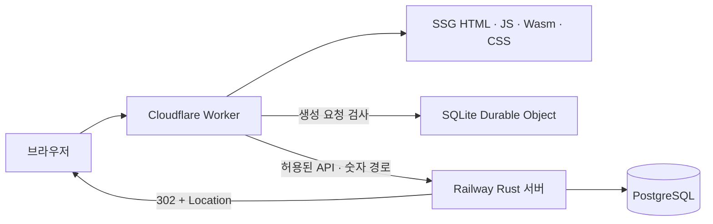

# 숫자형 단축 URL 서비스

## 배포 URL

- 서비스 URL: [숫자 URL 서비스](https://numeric-shortener.wonseok3662.workers.dev/)
- 테스트 단축 URL: [1번 단축 URL](https://numeric-shortener.wonseok3662.workers.dev/1)
- 테스트 원본 URL: [IANA 예약 도메인 안내](https://www.iana.org/domains/reserved?m5b2=shared#example)

현재 공개 서비스에서 **로그인 없이 숫자 주소를 생성할 수 있습니다**. 운영자 승인과 비용·보안 검토 후 공개했으며, 생성 요청은 IP별 5회/분·전체 20회/분으로 제한합니다. 무료 한도와 Railway Trial 잔액에 따라 서비스가 중단될 수 있습니다. 최신 운영 상태와 검증 범위는 [검증 기록](docs/verification.md)을 확인하세요.

## 프로젝트 소개

Rust와 Dioxus Fullstack으로 만든 숫자형 URL 단축 서비스입니다. HTTP·HTTPS 주소를 제출하면 PostgreSQL이 새 숫자 ID를 발급합니다. 같은 원본 주소도 제출할 때마다 다른 단축 URL을 받습니다. 수정·삭제 기능은 제공하지 않습니다.

## 기술 스택

| 구성 | 버전·역할 |
|---|---|
| Rust | 1.99.1, 서버와 UI 공통 프로젝트 |
| Dioxus / CLI | 0.7.10, Fullstack Server Function·SSG·Wasm hydration |
| PostgreSQL / SQLx | 로컬 PostgreSQL 17.11, 운영 PostgreSQL 18 / SQLx 0.8.6 |
| Cloudflare Workers | 정적 자산과 HTTP 프록시, Wrangler 4.160.0 |
| SQLite Durable Object | IP별 5회·전체 20회/60초 고정 시간창 |
| Railway | Linux Docker Rust 서버·비공개 DB·영속 볼륨 |
| Node.js / TypeScript | Node 24, 잠금 파일에 고정한 개발 도구 |

## 시스템 구조



Worker는 리디렉션을 따라가지 않고 원래 302를 전달합니다. 숫자 경로를 SPA HTML로 대체하지 않습니다. DB 관리자 접속 정보는 Rust 런타임에 제공하지 않습니다. [상세 구조](docs/architecture.md)

## 로컬 실행 방법

필수 도구: Rust/rustup, Windows C++ Build Tools·Windows SDK 또는 해당 OS의 Rust 빌드 도구, Dioxus CLI 0.7.10, Node.js 24, Docker Desktop. Windows DB 준비 스크립트는 **PowerShell 7**에서 실행합니다.

```powershell
rustup show
cargo install dioxus-cli --version 0.7.10 --locked
npm ci
```

이미 설치된 도구는 재설치하지 않아도 됩니다. rust-toolchain.toml이 Rust·Wasm 타깃을 지정합니다.

### PostgreSQL 준비

새 로컬 환경에서만 다음을 실행합니다. 스크립트는 기존 설정 파일·동일 이름 컨테이너·볼륨이 있으면 덮어쓰지 않고 중단합니다.

```powershell
pwsh -NoProfile -File scripts/setup-local-db.ps1
pwsh -NoProfile -File scripts/migrate-local-db.ps1
pwsh -NoProfile -File scripts/run-local.ps1 -Mode dev
```

개발 화면: http://127.0.0.1:18080

설정 파일 .env, .env.db, .env.migration은 로컬에서 생성되며 Git에서 제외됩니다. 기존 환경은 컨테이너를 재사용하고 초기화 스크립트를 다시 실행하지 마세요. 관리자·마이그레이션 역할·앱 역할을 분리하고 실제 마이그레이션은 앱 시작 시 실행하지 않습니다.

### 환경변수

[.env.example](.env.example)과 [.dev.vars.example](.dev.vars.example)은 예시만 포함합니다.

| 변수 | 설정 대상 | 설명 |
|---|---|---|
| DATABASE_URL | Rust | 제한 앱 계정 DB URL, 비밀 |
| PUBLIC_BASE_URL | Rust | 실제 Cloudflare 서비스 origin |
| IP / PORT | Rust | 운영 0.0.0.0 / Railway 주입 포트 |
| APP_ENV | Rust | 운영 production, 로컬 디버그 local |
| CREATE_URLS_ENABLED | Rust·Worker | 정확히 true일 때만 생성 허용, 기본 false |
| PROXY_SHARED_SECRET | Rust·Worker Secret | 서로 같은 임의 비밀, 32~256 ASCII 문자 |
| ALLOW_INSECURE_LOCAL_CREATE | Rust | 명시적 loopback 디버그에서만 true 허용 |
| SHORTENER_READ_ONLY_DEMO | UI 빌드 | true이면 생성 비활성 안내와 입력 잠금 |
| UPSTREAM_ORIGIN | Worker | Railway HTTPS origin |
| LOCAL_DEV | Worker | 운영 false, 로컬 loopback 검사 시 true |
| UPSTREAM_TIMEOUT_MS | Worker | upstream 제한시간, 기본 5000ms |
| RAILWAY_DEPLOYMENT_DRAINING_SECONDS | Railway | 10초 종료 유예 |

마이그레이션 관리자 접속 정보는 별도 관리하며 앱이 읽지 않습니다. 운영 비밀을 HTML·Wasm·소스·로그에 넣지 마세요.

## Railway 배포 방법

기존 서버 서비스의 Dockerfile을 사용합니다. 관리자 DB URL을 앱에 넣지 않고 제한 앱 계정 DATABASE_URL만 설정합니다. PORT 바인딩, /healthz, 종료 유예 10초, 생성 false를 먼저 확인합니다.

GitHub 연결 없이 프로젝트 환경에 한정된 Project Token을 필요한 CLI 프로세스에만 전달해 로컬 소스를 업로드할 수 있습니다. 토큰은 명령 인수·파일·채팅에 넣지 않습니다. 대상 프로젝트·환경·서비스를 명시하고 실제 빌드 SUCCESS·헬스체크를 확인합니다. [안전한 배포 순서](docs/deployment.md)

railway.toml은 기존 배포 설정의 참고 자료이고 .railway/railway.ts는 형식 검사한 선언 예시입니다. 자동 적용이나 새 서비스 생성용 명령은 실행하지 마세요.

## Cloudflare 배포 방법

먼저 SSG를 만들고 참조되는 자산만 준비합니다. 활성 UI를 만들 때는 아래 빌드 변수를 false로 바꿉니다. Worker·Rust 생성 설정은 별도로 관리합니다.

```powershell
$env:SHORTENER_READ_ONLY_DEMO='true'
$env:IP='127.0.0.1'
$env:PORT='18082'
dx build --web --release --ssg --force-sequential true
node scripts/prepare-assets.mjs
npx wrangler deploy --dry-run --outdir work/worker-dry-run
```

기존 dist/assets에 다른 빌드 자산이 있으면 준비 스크립트가 중단합니다. 새 ASSET_DESTINATION을 지정해 검증한 뒤 배포 설정의 자산 경로를 맞추세요. 실제 배포는 계정·무료 한도·대상·복구 절차를 확인한 뒤 수행합니다. 기존 Secret을 보존하고 UPSTREAM_ORIGIN을 설정하며, CREATION_LIMITER와 creation-limiter-v1 이력을 유지합니다. migration 태그를 지워 롤백하지 않습니다.

## 숫자 ID·동시성·중복 방지

BIGINT GENERATED ALWAYS AS IDENTITY PRIMARY KEY를 사용하고 INSERT ... RETURNING id로 생성 결과를 받습니다. 애플리케이션에서 MAX(id)+1을 계산하지 않습니다. PostgreSQL이 동시 요청의 서로 다른 ID와 기본키 고유성을 보장합니다. 원본 URL에는 UNIQUE 제약을 두지 않아 같은 URL도 새 ID를 받습니다. 실패·롤백으로 ID에 빈 번호가 생길 수 있으며 연속성을 보장하지 않습니다.

## 불변성 보장

앱 역할에는 id·original_url 조회와 original_url 삽입 권한만 있습니다. UPDATE·DELETE·TRUNCATE·DDL·시퀀스 변경·임의 ID 삽입은 거부합니다. 테이블 소유자와 앱 계정을 분리하고 수정·삭제 API도 제공하지 않습니다. DB 관리자 권한까지 막는 구조는 아닙니다.

## URL 검증·HTTP 리디렉션

빈 값, HTTP·HTTPS 외 스킴, 호스트 누락, 로컬·내부·특수 IP/도메인, 사용자정보, 제어문자·인코딩된 제어문자, 역슬래시, 자기 서비스 주소 및 8192바이트 초과 입력을 거절합니다. URL 파서로 정규화하며 경로·쿼리·프래그먼트를 보존합니다. 목적지 HTTP 조회나 DNS 조회는 하지 않습니다.

| 요청 결과 | HTTP |
|---|---|
| 생성 성공 | 200 + 생성 결과 JSON |
| 잘못된 원본 URL·숫자 경로 | 400 |
| 생성 비활성·직접 서버 생성 접근 | 403 |
| 없는 숫자 ID | 404 |
| 지원하지 않는 일반 메서드 | 405 + Allow |
| 요청 제한 초과 | 429 + Retry-After |
| DB·제한기 장애 또는 설정 누락 | 503 |
| upstream 연결 실패·시간초과 | 502 / 504 |
| 저장된 숫자 주소 이동 | 302 + Location |

생성 오류는 Dioxus ServerFnError의 실제 HTTP 상태로 반환합니다. 200 JSON 안의 오류 표시만으로 처리하지 않습니다. 생성 요청은 자동 재시도하지 않습니다.

## 테스트 및 검증 결과

```powershell
cargo fmt --all -- --check
cargo clippy --locked --no-default-features --features server --all-targets -- -D warnings
npm run typecheck
npm run test:worker
node scripts/test-integration.mjs
node scripts/verify-m5a2-local.mjs
docker build --tag numeric-shortener:verify .
```

통합 검사는 별도 이름의 PostgreSQL 컨테이너·볼륨과 임시 비밀을 생성하고 자신의 자원만 정리합니다. 기존 로컬 DB와 운영 DB를 대상으로 하지 않습니다. 먼저 위 SSG 빌드로 Windows 서버 실행 파일을 준비하세요. 개별 DB 검증 스크립트는 저장된 테스트 상태와 대상 DB에 의존하므로 통합 실행기를 권장합니다.

현재 수정본의 로컬 Rust 15개, Worker 19개, 실제 HTTP400/503, 중복·동시성·권한·302/404/405, 서버·DB 재시작, 실제 SQLite 동시30→허용20, SSG·Docker 빌드가 통과했습니다. 운영에서도 정상 생성200, 잘못된 URL 6종400, 302·404·405·429, 직접 접근403, 실제 클립보드와 별도 브라우저 이동을 확인했습니다. 제한 검증에서는 기존4건에5·6번만 추가해 총6건을 재배포 후 보존했습니다. 이후 별도 승인을 받아 공개 생성을 활성화했고, 추가 매핑 없이 활성 화면·서버 왕복·잘못된 URL400·직접 접근403을 확인했습니다. [검증 기록](docs/verification.md)에서 자동·수동·미실행 항목을 구분합니다.

## 알려진 제한 사항

- 공개 생성은 승인된 상태로 유지하지만, 무료 영구 운영이나 데이터의 영구 보존을 보장하지 않습니다. Trial 만료·크레딧 부족 시 서비스와 볼륨 보존 정책을 확인해야 합니다.
- IP별 고정 시간창은 NAT 사용자 공유, IPv6·여러 IP 우회, 경계 순간 burst 가능성이 있습니다.
- IP 해시는 익명화나 영구적인 개인정보 보호 보장이 아닙니다. 오래된 창은 요청 시 정리합니다.
- 목적지의 DNS·콘텐츠 안전성을 검사하지 않아 피싱·공개 도메인의 내부 IP 해석을 완전히 차단하지 않습니다. 서버가 목적지를 가져오지는 않습니다.
- 요청 제한은 Railway 청구의 절대 상한이 아닙니다. 생성 false라도 서버·DB·볼륨 비용이 발생할 수 있습니다.
- CONNECT는 Cloudflare Request 플랫폼 미지원으로 일반 애플리케이션 405 검사와 구분합니다.
- 운영 DB 장애 주입·재시작·UPDATE/DELETE 공격은 실행하지 않았습니다. 로컬 격리 환경에서 검사했습니다.
